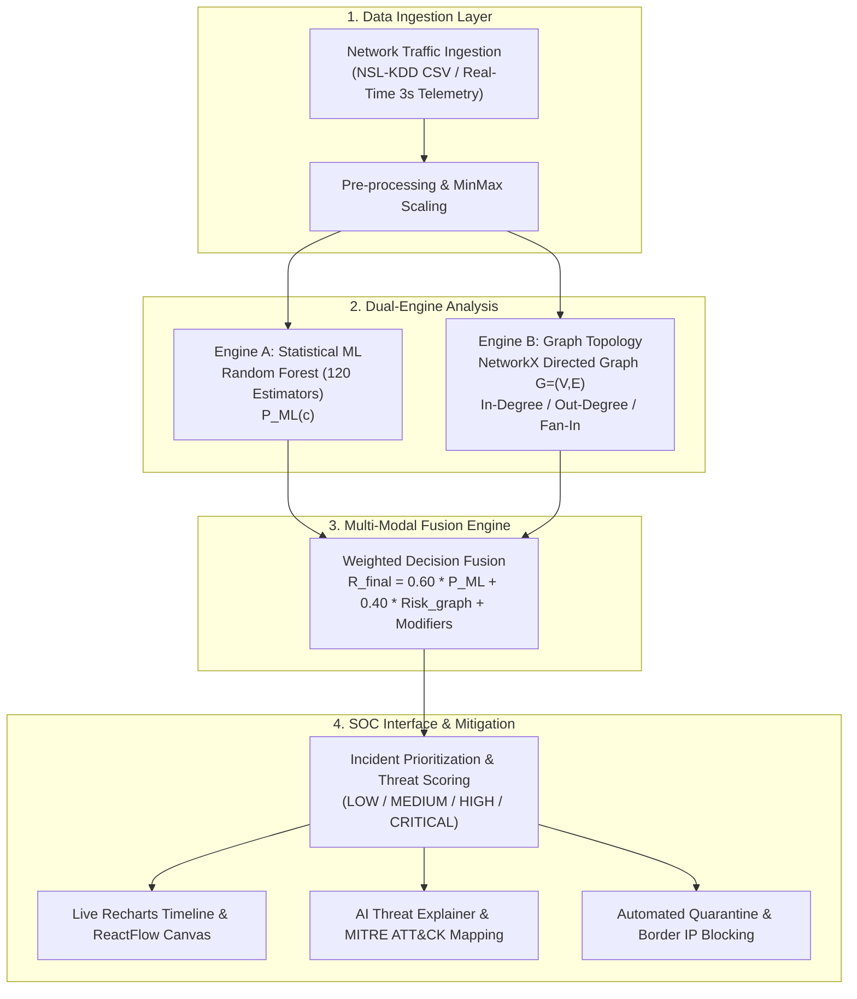

# DeepFusionGuard: System Architecture & Viva Technical Defense Guide

This document provides a comprehensive end-to-end breakdown of the **DeepFusionGuard** Cybersecurity Defense System, its mathematical fusion models, data ingestion mechanics, and sample questions for university viva examination.

---

## 1. Executive Summary & Problem Formulation

In modern enterprise networks, intrusion detection systems (IDS) face two classic failure modes:
1. **Unimodal ML Classifiers (Statistical only)**: Vulnerable to adversarial evasion, payload mutation, and zero-day packet drift.
2. **Topology Scanners (Graph only)**: High false-alarm rates when normal high-throughput batch operations occur (e.g. database backups, cluster sync).

**DeepFusionGuard** solves this via **Multi-Modal Decision Fusion**: combining fine-grained packet flow statistics (via Random Forest with 120 estimators) with topological graph metrics (NetworkX degree centrality, fan-in/fan-out ratios) into a calibrated risk score, coupled with an Explainable AI (XAI) inference module mapped to the **MITRE ATT&CK Enterprise Matrix**.

---

## 2. End-to-End System Architecture

---

## 3. Mathematical Foundations

### 3.1 Random Forest Probability Estimator
For input feature vector $\mathbf{x} \in \mathbb{R}^{d}$ across $M = 120$ decision trees:
$$P_{\text{ML}}(y = c \mid \mathbf{x}) = \frac{1}{M} \sum_{m=1}^{M} I(h_m(\mathbf{x}) = c)$$
Where:
- $h_m(\mathbf{x})$ is the classification output of tree $m$.
- Classes $c \in \{\text{Normal}, \text{DoS}, \text{Probe}, \text{R2L}, \text{U2R}\}$.

### 3.2 Graph Topological Risk Formulation
Given network communications modeled as a directed multi-graph $G = (V, E)$, for target node $v_t$:
$$\text{Fan-In Ratio } \phi_{\text{in}}(v_t) = \frac{\deg_{\text{in}}(v_t)}{\sum_{u \in V} \deg_{\text{in}}(u)}$$
$$\text{Fan-Out Ratio } \phi_{\text{out}}(v_s) = \frac{\deg_{\text{out}}(v_s)}{\sum_{u \in V} \deg_{\text{out}}(u)}$$

Topological risk score:
$$\text{Risk}_{\text{graph}} = \min\left(1.0, \; \alpha \cdot \phi_{\text{in}}(v_t) + \beta \cdot \phi_{\text{out}}(v_s) + \gamma \cdot \frac{\text{SYN\_count}}{\text{ACK\_count} + 1}\right)$$

### 3.3 Multi-Modal Calibrated Threat Score
The final actionable risk metric synthesized by DeepFusionGuard:
$$\mathcal{R}_{\text{final}} = w_1 \cdot P_{\text{ML}}(\text{Attack}) + w_2 \cdot \text{Risk}_{\text{graph}} + \delta_{\text{domain}}$$
- Default calibration weights: $w_1 = 0.60, \; w_2 = 0.40$
- Domain modifier $\delta_{\text{domain}} = +0.10$ if targeting critical core infrastructure ports (e.g., 22, 53, 443, 3389).

| Score Range | Severity Level | Automated Action |
|:---|:---|:---|
| $0.00 - 0.29$ | **LOW / BENIGN** | Allowed flow, standard audit logging |
| $0.30 - 0.59$ | **MEDIUM** | Rate-limiting, increased telemetry sampling |
| $0.60 - 0.79$ | **HIGH** | SOC alert dispatched, temporary IP quarantine |
| $0.80 - 1.00$ | **CRITICAL** | Automated border firewall drop rule (`iptables`), DEFCON 2 escalation |

---

## 4. Key Components & Implementation Matrix

| Module | Location | Primary Tech Stack | Purpose |
|:---|:---|:---|:---|
| **Vercel Serverless Entry** | `api/index.py` | Python 3.12, WSGI | Serverless proxy routing with PathRewriteMiddleware |
| **Backend REST Core** | `backend/app.py` | Flask, CORS, SQLite | Central SOC controller, Blueprint routing |
| **Database Engine** | `backend/database/db.py` | SQLite3 (`/tmp/` on Vercel) | Auto-seeding master admin, customers, alerts |
| **SOC Dashboard** | `frontend/src/pages/Dashboard.jsx` | React 19, Recharts, Lucide | Live packet velocity, DEFCON metrics, alert stream |
| **Topology Graph** | `frontend/src/pages/NetworkGraph.jsx` | @xyflow/react (ReactFlow) | Canvas visualizing attacker, victim, and benign nodes |
| **AI Threat Explainer** | `frontend/src/pages/AIThreatAnalysis.jsx` | React, Flask API | Plain-English reasoning, MITRE mapping, iptables rules |
| **Authentication Gateway**| `frontend/src/pages/Login.jsx` | JWT, Google OAuth 2.0 PKCE | Master Admin exclusivity & Analyst login portal |

---

## 5. University Viva: Frequently Asked Questions & High-Scoring Answers

### Q1: Why did you choose a Random Forest model instead of a simple Deep Neural Network?
> **Answer:** "Random Forest delivers three critical operational advantages for cybersecurity telemetry:
> 1. **Robustness to Class Imbalance**: In real-world NSL-KDD and live network traffic, attacks like U2R (User to Root) represent less than 1% of total flows. Random Forest with bootstrap aggregating prevents overfitting to majority classes.
> 2. **Sub-millisecond Inference**: Unlike deep sequential models, tree ensembles evaluate in $< 2\text{ms}$ on commodity CPU hardware without GPU acceleration requirements.
> 3. **Explainability**: Decision trees allow feature importance extraction (e.g. `src_bytes`, `serror_rate`), which directly feeds into our Explainable AI (XAI) engine for SOC analyst auditing."

### Q2: What is the purpose of the Graph Engine if ML already classifies packets?
> **Answer:** "Packet-level ML only inspects isolated flow records. A slow distributed portscan (APT Recon) or botnet SYN flood distributes small packet counts across hundreds of IP addresses, which individually look benign to a statistical classifier. By modeling the traffic as a directed graph in NetworkX, we calculate in-degree convergence (fan-in) and out-degree divergence (fan-out), exposing volumetric topology anomalies that ML alone misses."

### Q3: How does the system handle deployment on Vercel serverless environments?
> **Answer:** "Vercel serverless functions enforce a read-only root filesystem and ephemeral execution states. We engineered:
> 1. Automatic database path detection targeting `/tmp/deepfusionguard.db` with lazy auto-seeding on cold starts.
> 2. A custom WSGI `PathRewriteMiddleware` in `backend/app.py` to reconcile Vercel's `/api/*` path stripping with Flask blueprint routing.
> 3. Strict 1024MB memory allocation and 15-second execution ceilings configured in `vercel.json`."

### Q4: How is administrative exclusivity enforced for the Master Admin?
> **Answer:** "Administrative authorization is validated in `backend/database/db.py` and `backend/routes/auth.py`. While standard users can sign up and login, only the designated Master Admin email (`vasudevareddyeevuri@gmail.com`) is granted role `MASTER_ADMIN`. Only this role can access the Customer Directory modal, export Excel audit sheets, and execute destructive operations like dropping customer profiles or triggering network isolation."
